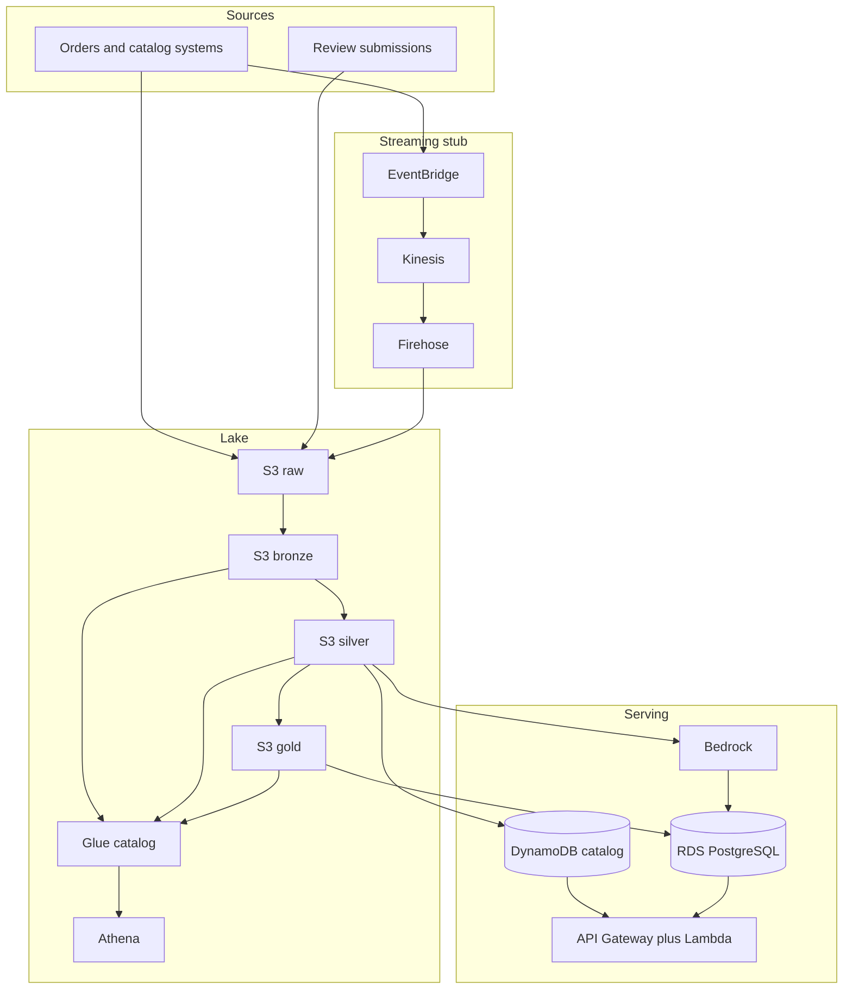

# Architecture

This platform is the data path for an e-commerce orders domain: customers, products, orders, and reviews. Upstream shop systems stay the source of transactions. This repository copies, shapes, and serves that data for engineering use and, later, for a BI owner.

Nothing here is deployed. The Terraform is a skeleton that `terraform validate` can check with no credentials.

## Data flow

Order lifecycle events are the only stream in this skeleton. Catalog files and reviews land as objects under `raw/` until they earn their own events. Firehose writes gzipped JSON to `raw/order-events/`, partitioned by arrival time. A local transform in [pipelines/](../pipelines/) collapses sample order events into gold order rows. Rewriting lake objects (bronze from the event timestamp, then silver and gold under the bucket) waits until a dev lake is applied. That job should be this same transform pointed at `raw/order-events/`.

Medallion prefixes, all in one bucket:

| Prefix | Contents |
| --- | --- |
| `raw/` | Source bytes. Stream landing and file drops. Treat as immutable. |
| `bronze/` | Decoded events, typed, partitioned, one row per source event. |
| `silver/` | Conformed customers, products, orders, and reviews. Money converted from decimal strings. |
| `gold/` | Small marts for Athena and for the load into RDS. |
| `athena-results/` | Query output. Expires after 7 days. |

## Service map

| Service | Job in this domain | In this skeleton |
| --- | --- | --- |
| S3 | Lake for orders, catalog, and reviews | One bucket, prefixes above, encryption, versioning, public access blocked |
| Glue | Catalog of lake tables, future job identity | Database and an IAM role. No crawler and no job |
| Athena | Analytical SQL for the BI owner and for ad hoc work | Workgroup writing results into the lake bucket |
| RDS PostgreSQL | Serving database: orders with their lines, customers, reviews | Private instance. Master password managed by Secrets Manager |
| DynamoDB | Product catalog reads by `product_id` and by `category` | On-demand table and one GSI |
| EventBridge | Bus for order domain events | Custom bus and a rule for placed, paid, shipped, cancelled |
| Kinesis | Buffer for those order events | On-demand stream, 24 hour retention |
| Firehose | Lands the stream in `raw/` | Delivery into the lake bucket |
| API Gateway and Lambda | Read API over the serving stores | `GET /health` only |
| Bedrock | Short summaries of product reviews | IAM role for `InvokeModel` and `Converse`. No call is made |
| SageMaker | A fine-tuned model, if one is ever required | Variable guard, no endpoint |
| CloudWatch and SNS | Platform alarms | RDS CPU, Kinesis iterator age, alarm topic with no subscriptions |
| VPC | Place the database off the public internet | Two private subnets, S3 and DynamoDB gateway endpoints |

Entity routes (`GET /orders/{order_id}`, `GET /products/{product_id}`) are documented in [services/README.md](../services/README.md) and are not registered on the API. Add them together with authentication. A health check is the only route a future apply would publish.

## Which store answers which question

| Question | Store |
| --- | --- |
| What is true for one order, including lines and customer? | RDS, once gold is loaded |
| What does this product look like to a shopper-facing read? | DynamoDB catalog projection |
| What happened across orders last quarter? | Athena on gold |
| What changed about an order in the last day? | Kinesis, then the lake via Firehose |
| What do recent reviews say, in one paragraph? | Bedrock, writing `reviews.summary` later |

Athena is the wrong tool for a single-order API lookup: latency and per-query bytes dominate. The API is aimed at RDS and DynamoDB. Analysts and the future BI owner query Athena, or connect a dashboard tool to Athena or RDS. This repo does not pick that dashboard tool.

The catalog table is a projection. The lake and the PostgreSQL `products` table are the copies this platform curates. DynamoDB is for key access and a category listing, which is a poor fit for a join-heavy order model. An order-status key-value projection can be a second table when a consumer exists. It should not replace the order tables.

## Environments

`dev`, `staging`, and `prod` share one root module, [infra/main.tf](../infra/main.tf). Each environment has its own example tfvars and its own state key under [infra/envs/](../infra/envs/). The environment name is a required variable, so a plan command names the target.

| | dev | staging | prod |
| --- | --- | --- | --- |
| Database class in the example | `db.t4g.micro` | `db.t4g.small` | `db.t4g.medium` |
| Multi-AZ | off | off | on |
| Backup retention | 1 day | 3 days | 7 days |
| Deletion protection | off | off | on |
| Final snapshot on destroy | skipped | skipped | required |
| API log retention | 7 days | 14 days | 30 days |
| VPC CIDR in the example | `10.10.0.0/16` | `10.20.0.0/16` | `10.30.0.0/16` |

RDS subnet groups need two availability zones even when Multi-AZ is off. The examples always declare two private subnets. Prod is the configuration that runs a standby. The committed dev tfvars keeps those subnet values only so the variables stay valid. It does not create the VPC or the database.

State locking uses the S3 lock file (`use_lockfile`), which needs Terraform 1.10 or newer. There is no DynamoDB lock table. The dev state bucket is `ecom-737334244495-dev-tfstate` in `eu-north-1`. The fmt/validate job still calls `terraform init -backend=false` and does not read state. The dev data lake workflow is the only automation that reads or writes that state, and only when someone runs it from `main`.

## Network and cost shape

The VPC has private subnets, no internet gateway, and no NAT gateway. The database is not publicly accessible. Reaching it from a laptop needs a path that does not exist yet (for example Session Manager). Gateway endpoints for S3 and DynamoDB are included because they have no hourly charge and they match where the data lives.

Interface endpoints for Glue, Secrets Manager, Kinesis, and Bedrock are hourly charges, in the same class as NAT. They wait until a workload inside the VPC has to call those APIs. The API Lambda stays outside the VPC so it does not need NAT to write logs. That also means this Lambda cannot open a socket to RDS. Order reads wait until there is a VPC path or another serving pattern worth the cost.

If this skeleton were applied later, the relational instance is the main idle bill. Kinesis on-demand and DynamoDB on-demand follow traffic. The skeleton omits NAT, MSK, interface endpoints, Glue crawlers, and SageMaker endpoints.

## Decisions

**Terraform.** The audience reviewing this is data engineering. Module diffs stay in the pull request, with no synthesized template.

**One root module and per-environment files.** `infra/envs/<env>/terraform.tfvars.example` and `backend.hcl.example` hold the differences. Workspaces hide the target inside ambient shell state. Passing `-var-file` keeps the environment on the command line. Copying an example to `terraform.tfvars` would auto-load it, so the documented command uses `-var-file` instead.

**One lake bucket.** Prefixes separate raw, bronze, silver, and gold. Identity policies can still be prefix-scoped. Separate buckets are a later split if a domain needs its own lifecycle or account boundary.

**RDS PostgreSQL for serving, Athena for scans.** The ops database holds the current normalized entities the API will read. Aurora is the upgrade when that database needs extra readers or serverless scaling. The instance class in the examples stays small on purpose.

**Explicit schemas, no crawler.** [data/schemas/](../data/schemas/) is the contract. A crawler would invent a second one.

**EventBridge, Kinesis, and Firehose.** Order events need a bus, a buffer, and a landing zone in the lake. MSK is the alternative when a consumer standard is already Kafka. Retention on the stream is 24 hours, which is a starting buffer, not a compliance archive. The archive is the lake.

**Kinesis encryption.** The stream uses the AWS-managed Kinesis key. Producer and delivery roles get a narrow `kms:ViaService` grant. S3, RDS, and DynamoDB are encrypted as well. A customer-managed key is the follow-up when key policy has to be account-specific.

**Bedrock for review summaries.** The workload is a short prompt over review text. The default model id is `amazon.nova-micro-v1:0`, a small text model, and it is a variable because model ids get retired. The module does not call the model. Some accounts require an inference-profile ARN that contains an account id; pass those ARNs in `bedrock_inference_profile_arns` when an account exists. Leave the list empty until then.

**SageMaker stays off.** `enable_sagemaker_endpoint` defaults to false and the module rejects true. An endpoint is a billable resource and needs model artifacts that this repo does not have.

**Secrets stay out of inputs.** No access key or database password is a Terraform input. The dev name prefix includes account `737334244495` so the lake bucket is globally unique: `ecom-737334244495-dev-lake`. Example files still use `example-ecom` and `REPLACE_ME_STATE_BUCKET`.

**First apply is the dev lake only.** `enable_*` defaults to true, so example tfvars still plan the full skeleton. `infra/envs/dev/terraform.tfvars` turns every flag off except the data lake, in `eu-north-1`. Analytics stays off: that module creates an IAM role the bucket does not need, and this account can reject new roles until advanced IAM is activated. Apply is a manual workflow run with the existing access keys. It does not use OIDC. A pull request plans and does not apply. A merge does not apply.

**API authentication is a feature, not a default.** Health is public if the stack is ever applied. Entity routes are absent until an authorizer exists. WAF can sit in front of that public API at the same time.

## Intentionally absent

NAT gateways, interface VPC endpoints, MSK, Glue jobs and crawlers, QuickSight or any other BI product, API authentication, WAF, budgets, customer-managed KMS keys, and an automatic `terraform apply` on push or merge. The dev S3 lake is the one manual apply.
